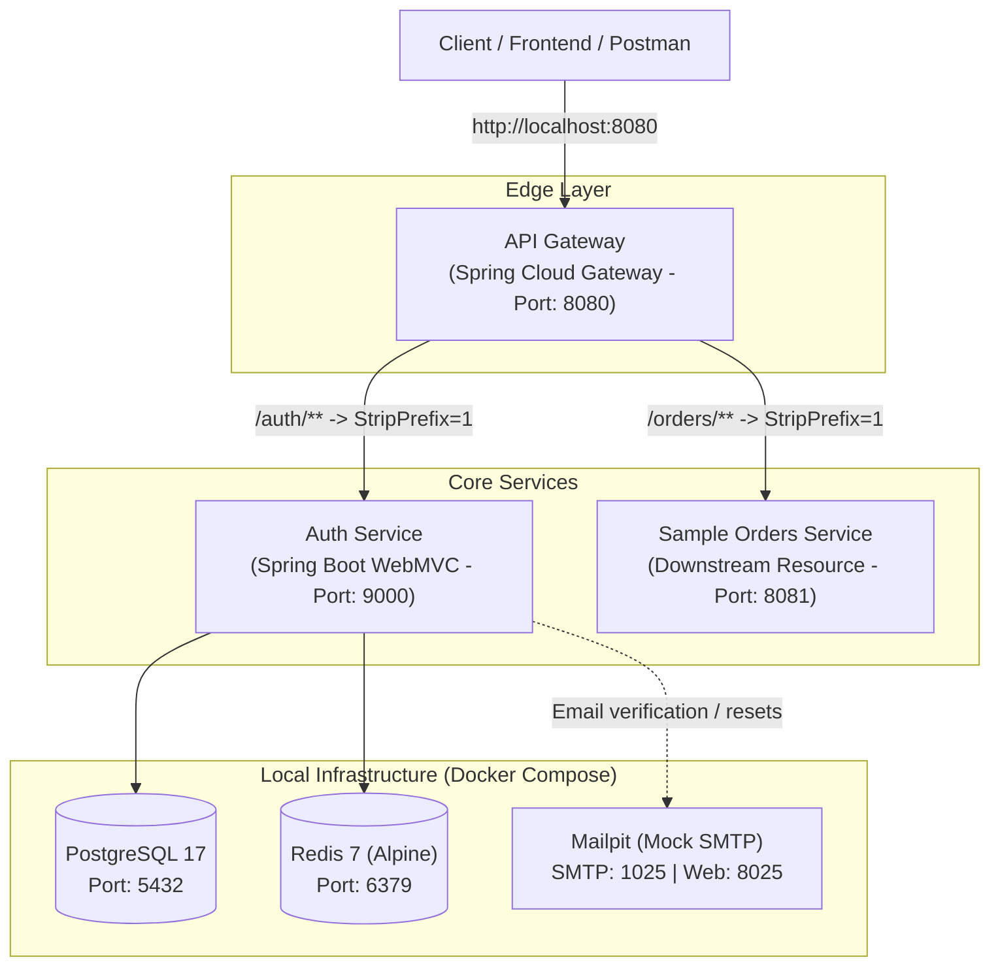

# AuthNexus

> **Production-Grade, Multi-Tenant Authentication & API Gateway Platform** built with Java 21, Spring Boot, Spring Cloud Gateway, PostgreSQL, and Redis.

---

## 🚀 Overview

**AuthNexus** provides a centralized, extensible identity, access management, and reverse proxy solution for distributed systems and microservices. Designed with multi-tenancy as a first-class citizen, AuthNexus handles edge routing, JWT issuance/revocation, organization isolation, and cross-cutting security.

For detailed phase-by-phase development logs, architectural blueprints, and upcoming roadmap items, refer to [`context.md`](context.md).

---

## 🏛️ System Architecture



---

## 📦 Services & Modules

| Module | Port | Technology | Purpose |
| :--- | :--- | :--- | :--- |
| **`services/api-gateway`** | `8080` | Spring Cloud Gateway (WebFlux) | Edge routing, reverse proxy, token verification, and rate limiting |
| **`services/auth-service`** | `9000` | Spring Boot, Spring Security, JPA | User registration, authentication, multi-tenancy, JWT issuance |
| **`services/sample-orders-service`** | `8081` | Spring Boot, Spring Security | Downstream resource service verifying end-to-end token propagation |

### Supporting Infrastructure (via Docker)
- **PostgreSQL 17**: Relational database with Flyway migration (`V1__create_organizations.sql`).
- **Redis 7 (Alpine)**: Fast in-memory cache and token revocation store.
- **Mailpit**: Mock SMTP (`1025`) and Web UI (`8025`) for email verification and password reset flows.

---

## 🛠️ Quick Start

### Prerequisites
- **Java 21** or later
- **Docker & Docker Compose**
- **Git**

### 1. Clone & Configure Environment
```bash
git clone https://github.com/thepriyanshiroy/AuthNexus.git
cd AuthNexus

# Copy example environment configuration
cp .env.example .env
```

### 2. Start Local Infrastructure
```bash
docker compose -f deploy/docker-compose.yml --env-file .env up -d
```

Verify containers are healthy:
```bash
docker compose -f deploy/docker-compose.yml ps
```

### 3. Build All Modules
```bash
# On Linux/macOS
./services/api-gateway/mvnw clean install -DskipTests

# On Windows
.\services\api-gateway\mvnw.cmd clean install -DskipTests
```

### 4. Run Services
In separate terminal windows:
```bash
# 1. Auth Service (Port 9000)
cd services/auth-service
mvn spring-boot:run

# 2. API Gateway (Port 8080)
cd services/api-gateway
mvn spring-boot:run

# 3. Sample Orders Service (Port 8081)
cd services/sample-orders-service
mvn spring-boot:run
```

---

## 🗺️ Project Roadmap

- [x] **Phase 1: Project Initialization & Infrastructure Scaffolding**
  - Multi-module Maven setup (Java 21, Spring Boot 4.x)
  - Docker Compose (PostgreSQL 17, Redis 7, Mailpit)
  - Flyway baseline schema (`organizations`)
  - Gateway routing configuration (`/auth/**`, `/orders/**`)
- [ ] **Phase 2: Core Identity, User Management & Authentication (Auth-Service)**
- [ ] **Phase 3: Multi-Tenancy & Role-Based Access Control (RBAC)**
- [ ] **Phase 4: API Gateway Security Filters & Token Propagation**
- [ ] **Phase 5: Downstream Resource Protection & End-to-End Verification**
- [ ] **Phase 6: Email Verification, Password Resets & MFA**
- [ ] **Phase 7: Observability, Resilience & Production Hardening**

See [`context.md`](context.md) for full context and architecture decisions.

---

## 📄 License
This project is open-source and available under the [MIT License](LICENSE).
