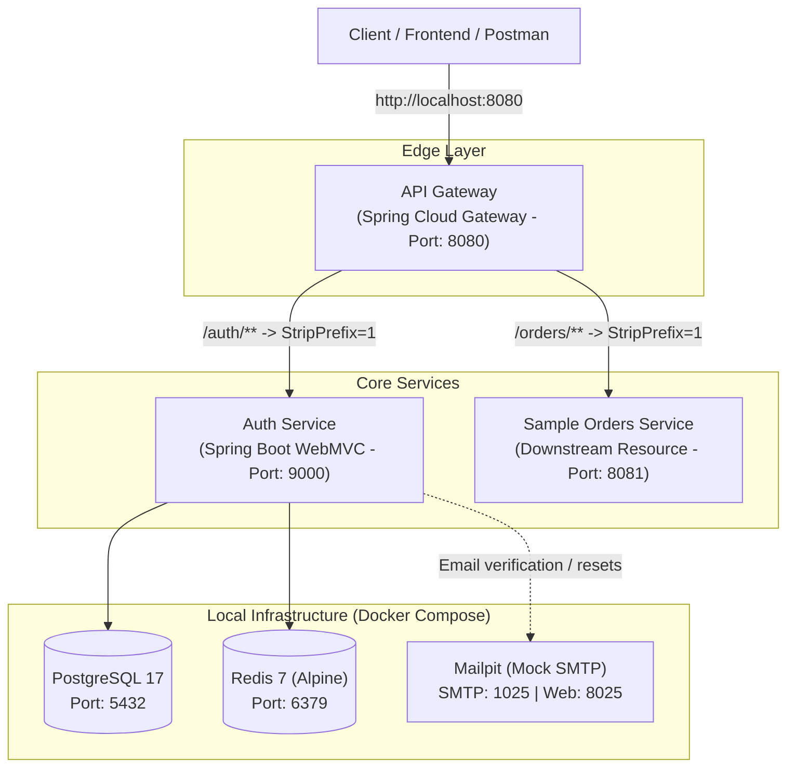

# AuthGateway — Project Context & Evolution Log

> **Note for Developer & AI Assistant**:
> This file is the single source of truth for the context, architecture, tech stack, and phase progression of the **AuthGateway** platform. With every new phase, this document is updated to reflect current state, completed milestones, decisions made, and upcoming priorities.

---

## 1. Project Overview & Mission

**AuthGateway** is a reusable, modular, and production-grade **Authentication and API Gateway Platform** designed for distributed systems and microservice architectures.

### Key Objectives:

- **Centralized Edge Gateway**: Single ingress point for downstream microservices handling routing, cross-cutting security, SSL termination, and rate limiting.
- **Robust Identity & Access Management (IAM)**: Centralized authentication service providing multi-tenancy, secure user authentication, token issuance/refresh (JWT), and token revocation.
- **Multi-Tenancy from Day One**: Built-in organizational scoping (`Organization` / `Tenant`) so services can easily support B2B SaaS requirements.
- **Developer-Friendly Local Environment**: Fully containerized supporting infrastructure (PostgreSQL, Redis, Mailpit) for zero-friction local development.
- **Reference Integration**: A sample downstream resource service (`sample-orders-service`) to prove out end-to-end authentication, header propagation, and authorization.

---

## 2. High-Level Architecture & Topology



### Network & Port Allocation

| Component                 | Type             | Local Port | Protocol / Notes                         |
| :------------------------ | :--------------- | :--------- | :--------------------------------------- |
| **api-gateway**           | Microservice     | `8080`     | Spring Cloud Gateway (Reactive WebFlux)  |
| **auth-service**          | Microservice     | `9000`     | Core IAM Service (Spring Boot WebMVC)    |
| **sample-orders-service** | Microservice     | `8081`     | Sample protected resource service        |
| **PostgreSQL**            | Docker Container | `5432`     | Database: `authgateway`, Healthchecked   |
| **Redis**                 | Docker Container | `6379`     | Key-value store for session/token cache  |
| **Mailpit Web UI**        | Docker Container | `8025`     | Local web UI to inspect outbound emails  |
| **Mailpit SMTP**          | Docker Container | `1025`     | Mock SMTP server for dev email workflows |

---

## 3. Technology Stack

- **Language & Runtime**: Java 21 (LTS)
- **Framework Ecosystem**:
  - Spring Boot 4.1.2
  - Spring Cloud Gateway Server Webflux (2025.1.4)
  - Spring Security
  - Spring Data JPA (Hibernate)
  - Spring Data Redis
  - Spring Boot Actuator
- **Data & Migration**:
  - PostgreSQL 17 (Relational Database)
  - Flyway (`flyway-database-postgresql`) for schema migrations
  - Redis 7 (In-memory token & session storage)
- **Tooling & Orchestration**:
  - Apache Maven (Multi-module parent POM)
  - Docker & Docker Compose

---

## 4. Phase History & Status Log

### Legend:

- `[COMPLETED]` — Milestone fully implemented and verified
- `[IN PROGRESS]` — Currently active milestone
- `[PLANNED]` — Queued for subsequent implementation

---

### [COMPLETED] Phase 1: Project Initialization & Infrastructure Scaffolding

#### Summary:

Phase 1 focused on bootstrapping the multi-module Maven repository structure, standing up local containerized infrastructure, configuring database and cache connections, establishing Flyway migrations, and creating baseline gateway routing.

#### Deliverables & Implementation Details:

1. **Multi-Module Maven Structure**:
   - Created root aggregator [`pom.xml`](file:///c:/Users/thera/OneDrive/Documents/authgateway/pom.xml) orchestrating three distinct sub-modules:
     - `services/api-gateway`
     - `services/auth-service`
     - `services/sample-orders-service`
   - Configured parent references, dependencies, and build plugins for Java 21 across all services.

2. **Local Infrastructure via Docker Compose**:
   - Created [`deploy/docker-compose.yml`](file:///c:/Users/thera/OneDrive/Documents/authgateway/deploy/docker-compose.yml) hosting:
     - **PostgreSQL 17** (`authgateway-postgres`) with persistent volume `postgres_data` and healthcheck (`pg_isready`).
     - **Redis 7-alpine** (`authgateway-redis`) with password authentication, persistent volume `redis_data`, and healthcheck (`redis-cli ping`).
     - **Mailpit** (`authgateway-mailpit`) with mock SMTP on `1025` and HTTP UI on `8025`.
   - Initialized root [`.env`](file:///c:/Users/thera/OneDrive/Documents/authgateway/.env) holding credentials for local database and redis.
   - Configured root [`.gitignore`](file:///c:/Users/thera/OneDrive/Documents/authgateway/.gitignore) protecting secrets, build outputs (`target/`), IDE settings, and logs.

3. **Database Schema & Migrations (`auth-service`)**:
   - Integrated Flyway database migration runner.
   - Established initial baseline migration [`V1__create_organizations.sql`](file:///c:/Users/thera/OneDrive/Documents/authgateway/services/auth-service/src/main/resources/db/migration/V1__create_organizations.sql):
     - Created `organizations` table (`id UUID PK`, `name VARCHAR(150)`, `slug VARCHAR(100) UNIQUE`, timestamps).
     - Created index on `organizations.name` for fast lookup.
     - Lays the multi-tenant foundational entity for users and domains.

4. **API Gateway Routing Baseline (`api-gateway`)**:
   - Configured reactive routing via [`services/api-gateway/src/main/resources/application.yml`](file:///c:/Users/thera/OneDrive/Documents/authgateway/services/api-gateway/src/main/resources/application.yml):
     - Route `auth-service-route`: `/auth/**` stripped by prefix 1 and forwarded to `http://localhost:9000`.
     - Route `orders-service-route`: `/orders/**` stripped by prefix 1 and forwarded to `http://localhost:8081`.
   - Enabled Spring Boot Actuator endpoints (`health`, `info`).

5. **Sample Downstream Resource Skeleton (`sample-orders-service`)**:
   - Created starter Spring Boot service on port `8081` with Spring Security and Actuator to serve as verification target for Phase 4 & 5 token validation.

---

### [PLANNED] Phase 2: Core Identity, User Management & Authentication (Auth-Service)

- **Goal**: Implement identity persistence, registration, login, and JWT token issuance.
- **Scope**:
  - Flyway migration `V2`: `users`, `user_credentials`, `roles` tables.
  - Domain entities, repositories, and DTOs.
  - Password hashing with BCrypt / Argon2.
  - Registration & Login endpoints (`POST /api/v1/auth/register`, `POST /api/v1/auth/login`).
  - JWT token provider (access token generation with RSA/HMAC + refresh token mechanism).
  - Redis-backed refresh token storage and revocation whitelist/blacklist.

---

### [PLANNED] Phase 3: Multi-Tenancy & Role-Based Access Control (RBAC)

- **Goal**: Multi-organization association, role assignments, and permission evaluations.
- **Scope**:
  - Organization memberships (`user_organizations` join with roles like `OWNER`, `ADMIN`, `MEMBER`).
  - Multi-tenant tenant context resolver.
  - Organization management APIs (Create, Invite, Switch tenant).

---

### [PLANNED] Phase 4: API Gateway Security Filters & Token Propagation

- **Goal**: Transform `api-gateway` into a secure edge proxy.
- **Scope**:
  - Custom Reactive Gateway Filter for JWT verification.
  - Public route whitelist (`/auth/login`, `/auth/register`, `/actuator/**`).
  - Downstream header decoration:
    - `X-User-Id`
    - `X-User-Email`
    - `X-Organization-Id`
    - `X-Roles`
  - Redis-based request rate limiting (Token Bucket via Spring Cloud Gateway Redis RateLimiter).

---

### [PLANNED] Phase 5: Downstream Resource Protection & End-to-End Verification

- **Goal**: Secure `sample-orders-service` and verify zero-trust architecture.
- **Scope**:
  - Configure downstream security filter extracting caller context from trusted gateway headers.
  - Implement sample order endpoints (`GET /orders`, `POST /orders`) scoped by tenant and user.
  - End-to-end integration test: Client -> Gateway -> Auth Service (login) -> Gateway (with Bearer JWT) -> Sample Orders Service.

---

### [PLANNED] Phase 6: Email Verification, Password Resets & MFA

- **Goal**: Production-readiness IAM flows.
- **Scope**:
  - Integrate Spring Mail with Mailpit SMTP (`localhost:1025`).
  - Account verification email token flow.
  - Forgot password / reset password workflow.
  - Optional: TOTP / Multi-Factor Authentication.

---

### [PLANNED] Phase 7: Observability, Resilience & Production Hardening

- **Goal**: Production readiness, monitoring, and packaging.
- **Scope**:
  - Distributed tracing with Micrometer Tracing & Zipkin/Otel.
  - Structured JSON logging with correlation IDs (`traceId`, `spanId`).
  - Circuit Breakers (Resilience4j) on Gateway routes.
  - Multi-stage Dockerfiles for all microservices.

---

## 5. Quick-Start Guide for Local Development

### 1. Start Local Infrastructure

From the repository root:

```bash
docker compose -f deploy/docker-compose.yml --env-file .env up -d
```

Verify containers are running:

```bash
docker compose -f deploy/docker-compose.yml ps
```

### 2. Build All Services

```bash
mvn clean install -DskipTests
```

### 3. Launch Services (Separate Terminals)

- **Auth Service**:
  ```bash
  cd services/auth-service
  ./mvnw spring-boot:run
  ```
- **API Gateway**:
  ```bash
  cd services/api-gateway
  ./mvnw spring-boot:run
  ```
- **Sample Orders Service**:
  ```bash
  cd services/sample-orders-service
  ./mvnw spring-boot:run
  ```

---

## 6. Phase Evolution Protocol (How We Update This File)

When moving across phases, we adhere to the following checklist:

1. **Status Update**: Mark the completed phase as `[COMPLETED]` and document the concrete technical decisions, file changes, and endpoints introduced.
2. **Next Phase Activation**: Update the upcoming phase to `[IN PROGRESS]` with specific implementation tasks.
3. **Architecture / Route Updates**: If new services, ports, routes, or database tables are added, update Section 2 (Topology) and Section 3 (Stack).
4. **Verification Evidence**: Keep the Quick-Start section updated so any contributor or AI session can run and verify the codebase immediately.
